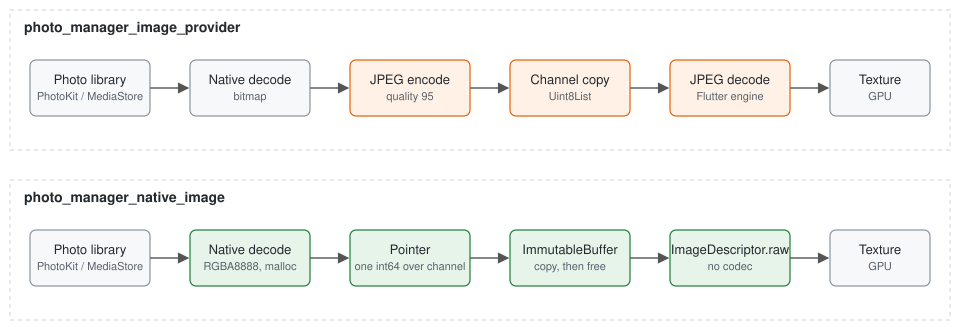

# photo_manager_native_image

[](https://pub.dev/packages/photo_manager_native_image)
[](https://pub.dev/packages/photo_manager_native_image/score)
[](https://github.com/toyaji/photo_manager_native_image/actions/workflows/photo_manager_native_image.yml)
[](https://github.com/toyaji/photo_manager_native_image/blob/main/LICENSE)

Fast, cancellable thumbnails for photo library grids. Show an
[`AssetEntity`](https://pub.dev/documentation/photo_manager/latest/photo_manager/AssetEntity-class.html)
from [`photo_manager`](https://pub.dev/packages/photo_manager) as **native
RGBA pixels** — no JPEG is encoded or decoded between the photo library and
the screen.

`photo_manager` hands Flutter thumbnail *bytes*: the platform decodes the
photo, re-encodes it as JPEG, copies it across the method channel, and Flutter
decodes it again — two decodes and two copies per grid cell, with no way to
cancel. This package decodes once on the platform, straight to RGBA, and gives
Flutter a pointer to the pixels.



```dart
Image(image: NativeImageProvider(asset, size: 320), fit: BoxFit.cover);

// or the convenience widget
NativeAssetImage(asset, size: 320, fit: BoxFit.cover);
```

## Features

- **One decode, one copy.** Pixels go from the platform decoder to
  `ImageDescriptor.raw` through `dart:ffi`; nothing is re-encoded.
- **Cancellable.** A cell scrolled away before its pixels arrive stops its
  native work. `imageCache.clear()` never blanks a visible cell.
- **Memory-bounded.** Decoded to the size you ask for, panoramas capped,
  native buffers freed on every path.
- **iCloud aware** on iOS: local first, then one low-priority download only
  when needed, and a typed error when it fails.
- **Sharp on Android.** Large sizes decode from the original instead of the
  soft system thumbnail; the switch-over size is yours to choose.
- **HDR photos.** An optional view applies the gain map of Apple HDR and
  Ultra HDR photos on HDR displays.
- **Drop-in.** A plain `ImageProvider` and an `Image` widget shaped like
  `photo_manager_image_provider`'s.

| | Android | iOS |
|---|---|---|
| Minimum version | API 26 | iOS 13 |
| Decoder | `ImageDecoder` (API 29+), `BitmapFactory` (API 26–28) | `PHImageManager` + `vImage` |
| JPEG round trips | 0 | 0 |

macOS, web and desktop are not supported.

## Getting started

### 1. Install

```sh
flutter pub add photo_manager photo_manager_native_image
```

Flutter 3.24 or later is required. Building iOS with Swift Package Manager
needs Flutter 3.44; on older Flutter keep the app on CocoaPods. See
[Requirements](#requirements).

### 2. Set up photo library access

The package reads the library through `photo_manager`, so the app needs the
platform setup `photo_manager` describes in its
[README](https://pub.dev/packages/photo_manager#prepare-for-use):
`READ_MEDIA_IMAGES` / `READ_MEDIA_VIDEO` (Android 13+) or
`READ_EXTERNAL_STORAGE` (Android 12 and below) in `AndroidManifest.xml`, and
`NSPhotoLibraryUsageDescription` in iOS `Info.plist`.

### 3. Ask for permission, then show the grid

The package never asks for permission itself:

```dart
final PermissionState ps = await PhotoManager.requestPermissionExtend();
if (!ps.hasAccess) return;

final List<AssetPathEntity> paths = await PhotoManager.getAssetPathList();
final List<AssetEntity> assets =
    await paths.first.getAssetListPaged(page: 0, size: 200);

GridView.builder(
  gridDelegate:
      const SliverGridDelegateWithFixedCrossAxisCount(crossAxisCount: 4),
  itemCount: assets.length,
  itemBuilder: (context, i) =>
      NativeAssetImage(assets[i], size: 256, fit: BoxFit.cover),
);
```

A pinch-to-zoom grid with a live instrumentation panel is in the
[example app](https://github.com/toyaji/photo_manager_native_image/tree/main/example).

## Usage

### Choose a size

`size` is the pixel length of the **shorter** side, so a 320 request for a
4:3 photo yields about 427 × 320. For a grid cell, ask for the cell's size in
physical pixels and draw with `BoxFit.cover`:

```dart
final int size =
    (cellWidth * MediaQuery.devicePixelRatioOf(context)).round();
```

Every distinct size is a separate decode and cache entry, so a grid that
pinches between column counts does better with a few fixed sizes than with
one per layout.

### Handle errors

```dart
NativeAssetImage(
  asset,
  size: 320,
  errorBuilder: (context, error, _) {
    if (error is NativeImageException &&
        error.code == NativeImageErrorCode.icloudNotDownloaded) {
      return const Icon(Icons.cloud_download);
    }
    return const Icon(Icons.broken_image);
  },
);
```

| Code | Meaning |
|---|---|
| `notFound` | The asset no longer exists |
| `icloudNotDownloaded` | iOS: only in iCloud and the download failed, for example offline |
| `decodeFailed` | The platform could not produce pixels (on Android this includes a revoked permission) |

A failed image is evicted from `ImageCache`, so the next build tries again.

### Sharpness vs. speed on Android

On Android 10+ small sizes come from the MediaStore system thumbnail, which is
fast but a recompressed JPEG; larger sizes decode the original, which is
sharper but costs more per image. `androidOriginalDecodeAbove` sets where that
switch happens — 256 px by default:

```dart
// Favour speed: use the system thumbnail up to 512 px.
NativeAssetImage(asset, size: 400, androidOriginalDecodeAbove: 512);

// Favour sharpness: always decode the original.
NativeAssetImage(asset, size: 200, androidOriginalDecodeAbove: 0);
```

Videos and iOS ignore it.

### HDR photos

`NativeAssetImage` shows 8-bit sRGB pixels, so the gain map of an Apple HDR
HEIC or Ultra HDR JPEG is not applied. Stack `NativeAssetHdrView` above it to
show the HDR version on HDR displays:

```dart
Stack(
  fit: StackFit.expand,
  children: [
    NativeAssetImage(asset, size: 1080, fit: BoxFit.cover),
    NativeAssetHdrView(asset, size: 1080),
  ],
);
```

The view stays transparent for SDR photos, before iOS 17 / Android 14, and on
failure, so the image below always shows. On Android the app must put the
activity window in HDR color mode itself. Details:
[HDR photos](https://github.com/toyaji/photo_manager_native_image/blob/main/doc/hdr.md).

### iCloud (iOS)

Nothing to configure. A request first asks PhotoKit for a local result; only
if the asset is in iCloud and the size needs the original does one more
request download it, on a low-priority queue that never blocks on-screen
thumbnails. Small sizes are usually served from the on-device preview even
offline.

## API at a glance

| Type | Role |
|---|---|
| `NativeImageProvider(entity, size:, androidOriginalDecodeAbove:)` | The `ImageProvider`. Keyed by asset id, modified date, size and the Android threshold, so edited photos reload. |
| `NativeAssetImage(entity, size:, ...)` | An `Image` with the same parameters and defaults as `AssetEntityImage`. |
| `NativeAssetHdrView(entity, size:)` | Native view that draws the HDR version above a regular image. |
| `NativeImageException`, `NativeImageErrorCode` | Typed failure passed to `errorBuilder`. |

Full reference on
[pub.dev](https://pub.dev/documentation/photo_manager_native_image/latest/).

## What your app owns

The package turns "this asset at this size" into a frame and cleans up after
itself. The app decides:

- **Which sizes exist** and how many requests are in flight (`cacheExtent`,
  prefetching, layout changes during a pinch). The package queues what it is
  asked and cancels what is no longer needed; it does not throttle.
- **The `ImageCache` budget.** The package uses `PaintingBinding.imageCache`
  and adds no cache of its own, in memory or on disk.
- **Error and loading UI.**

Details: [ownership and internals](https://github.com/toyaji/photo_manager_native_image/blob/main/doc/ownership.md).

## Requirements

| | Minimum |
|---|---|
| Flutter | 3.24 (CocoaPods) / 3.44 (Swift Package Manager) |
| Android | API 26 |
| iOS | 13 (HDR view: iOS 17, Android 14) |
| `photo_manager` | 3.x |

- Swift Package Manager builds need the `FlutterFramework` package, which
  `photo_manager` 3.12 builds against only from Flutter 3.44. On older Flutter
  add `disable-swift-package-manager: true` under `flutter:` in the app's
  `pubspec.yaml`.
- CI builds a new app against both minimums and current stable on every push.

## Not supported

Disk caching, prefetching, resolution tiers and `photo_manager_image_provider`
compatibility shims — those belong to the app. macOS, web and desktop.

## Learn more

- [How it works](https://github.com/toyaji/photo_manager_native_image/blob/main/doc/how-it-works.md) — request lifecycle, cancellation, sizing and iCloud in detail
- [Ownership and internals](https://github.com/toyaji/photo_manager_native_image/blob/main/doc/ownership.md) — worker queues, buffer lifetime, instrumentation, tested configurations
- [HDR photos](https://github.com/toyaji/photo_manager_native_image/blob/main/doc/hdr.md) — `NativeAssetHdrView` on iOS and Android
- [Changelog](https://github.com/toyaji/photo_manager_native_image/blob/main/CHANGELOG.md)

## Contributing

Bug reports and pull requests are welcome on
[GitHub](https://github.com/toyaji/photo_manager_native_image/issues).
The package's own tests and code generation need Flutter 3.44 or later
(`pigeon` 27 needs `meta` 1.18):

```sh
flutter test
dart run pigeon --input pigeons/native_image_api.dart
```

## License

[Apache-2.0](https://github.com/toyaji/photo_manager_native_image/blob/main/LICENSE).
