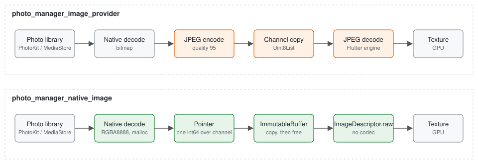
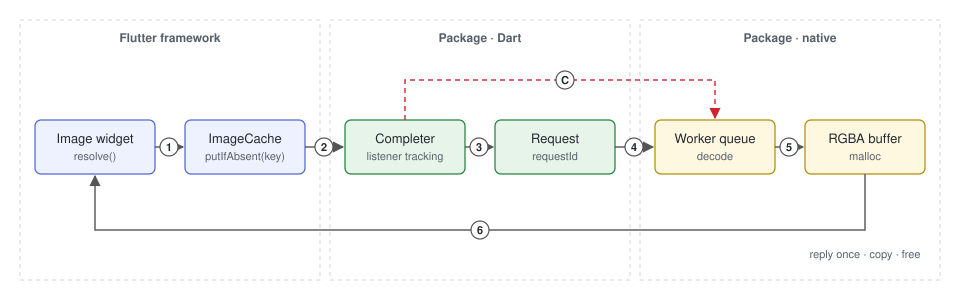

# How it works

What happens between `NativeImageProvider` and a frame on screen.

## Compared with `photo_manager_image_provider`



`AssetEntityImageProvider` asks `photo_manager` for thumbnail *bytes*. The
platform decodes the asset, re-encodes it as JPEG (quality 95 on iOS), copies
the bytes across the method channel, and Flutter decodes the JPEG again. For a
grid that is two decodes and two copies per cell, and the request cannot be
cancelled once it has been sent.

This package keeps the pixels native. The platform decodes once, straight to
premultiplied RGBA, and sends back four integers: pointer, width, height, row
bytes. Dart copies the buffer into an `ImmutableBuffer`, frees the pointer, and
builds the image from the raw descriptor. There is no codec on the Dart side.

| | `AssetEntityImageProvider` | `NativeImageProvider` |
|---|---|---|
| Wire format | JPEG / PNG bytes | pointer to RGBA |
| Decodes | 2 (native + Dart) | 1 (native) |
| Copies | 2 (channel + engine) | 1 (`ImmutableBuffer`) |
| Cancellation | none | before the buffer is allocated |
| Sizing | `ThumbnailSize(width, height)` box | `size` = shorter side |
| Cache key | id, size, format, original flag | id, modified date, size, isVideo, `androidOriginalDecodeAbove` |
| Errors | `StateError` / platform message | `NativeImageException(code)` |
| iCloud | downloads inline, blocking the request | local first, then one low-priority network attempt only when needed |

Both providers are plain `ImageProvider`s and can coexist in one app.

## Request lifecycle



1. An `Image` widget resolves the provider. The key is the provider itself:
   `(entity.id, modifiedDateSecond ?? createDateSecond, size, isVideo, androidOriginalDecodeAbove)`.
2. `ImageCache.putIfAbsent` finds no entry and asks the provider for a
   completer. The cache attaches its own listener first; the widget's listener
   is attached right after. The completer remembers which one is the cache's.
3. The completer starts a request with a fresh `requestId` and sends it over
   the Pigeon channel.
4. The platform puts the request on a worker queue. Nothing blocks the platform
   thread.
5. A worker decodes, converts to RGBA, and allocates a `malloc` buffer. From
   this point the request cannot be cancelled: the buffer is Dart's to free.
6. The platform replies exactly once. Dart copies the buffer into an
   `ImmutableBuffer`, frees the pointer on every path (success, cancel, error),
   and hands the frame to the completer. `ImageCache` keeps it; the widget
   paints it.

**C — cancellation.** When the completer's last *widget* listener leaves and
no image has arrived, it sends `cancelRequest(requestId)` and evicts the key
from `ImageCache`. On the platform, a request that has not reached step 5 is
dropped and replies `null`; one that has already allocated still replies with
the buffer, which Dart frees and discards.

What a cancel stops depends on where the request is:

| Request state | On cancel |
|---|---|
| Waiting in the queue | Dropped; no work is done |
| Decoding a local asset | Runs to the end (milliseconds); the result is discarded |
| Downloading from iCloud (iOS, network attempt) | The download is cancelled and the slot freed immediately |

Local decodes are not interrupted on purpose: measured on devices, stopping them
saved little worker time and did not change queue wait or decode time.

Two situations look like "the last listener left" but are not:

- `imageCache.clear()` (memory pressure) detaches only the cache's listener.
  The widget is still on screen, so the request keeps going.
- A cache listener that detaches synchronously inside `addListener` (the
  completer already had an image) never counted as a waiter.

The completer tells these apart because it locked in the first listener as the
cache's in step 2. `imageCache.clear()` therefore never produces a blank cell,
and a scrolled-away cell always stops its native work.

## Sizing

`size` is the pixel length of the **shorter** side after aspect-fill, so a
320 request for a 4:3 photo yields about 427 × 320. The platform never
upscales. If it returns something larger than asked (PhotoKit's `.fast`
resize can), Dart scales it down once through `instantiateCodec`.

Very wide or tall images are also capped at `size² × 4` pixels, so a 1024
request for an 8000 × 1000 panorama yields 5793 × 724 instead of the full
32 MB bitmap.

On Android 10 and later an image at or below `androidOriginalDecodeAbove`
(256 px by default) comes from the MediaStore system thumbnail, which is
fast; above it the original is decoded, which is sharper but costs more per
image. The system thumbnail is a recompressed JPEG and looks soft at larger
sizes. Raise the value to favour speed, or pass `0` to always decode the
original:

```dart
NativeAssetImage(asset, size: 400, androidOriginalDecodeAbove: 512);
```

Videos ignore it: up to 768 px they keep the system thumbnail even when it is
smaller than asked, because a frame read from the video itself can be a
different frame, and one video must show one picture at every size. Above
768 px the frame is read from the video.

Wide-gamut photos (Display P3) are converted to sRGB on both platforms,
because Flutter reads the raw pixels as sRGB.

For a square grid cell, ask for the cell's pixel size and draw with
`BoxFit.cover`. For a dense grid a smaller size over a shared base layer is
cheaper than one size per column count, because the key never changes during
a pinch.

## iCloud (iOS)

Nothing to configure. A request first asks PhotoKit for a local result. If
the asset is only in iCloud and the requested size needs the original, one
more request follows with network access, on a low-priority queue with two
slots, so downloads never block on-screen thumbnails. The frame fills the same
cache key. If the download fails too (for example offline), the request ends
with `icloudNotDownloaded`.

Small sizes usually never reach the network: in our tests an iPhone answered
iCloud-only photos up to about 360 px on the shorter side from the on-device
preview, even offline. On Android all MediaStore assets are local.

[← Back to README](https://github.com/toyaji/photo_manager_native_image/blob/main/README.md)
