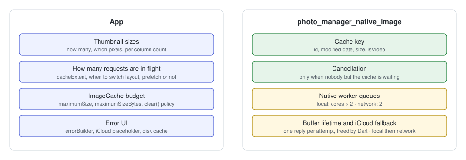

# Ownership and internals

Which concerns belong to the package and which to the app, and how to check them on a device.

## Who owns what

The package owns everything between "this key needs pixels" and "here is a
frame". The app owns every policy decision above that.

| Concern | Owner | Notes |
|---|---|---|
| Which pixel sizes exist | App | e.g. 128 for dense grids, 320 for 2–6 columns. Pass the number; the package does not define tiers. |
| How many requests are in flight | App | Driven by `cacheExtent`, layout changes during a pinch, prefetching. The package queues whatever it is asked and cancels what stops being needed; it does not throttle, except that Android decodes frames of videos with more than 3840 × 2160 pixels one at a time. The app may choose `NativeImageProvider.androidDecodeOrder` and name the assets on screen with `AndroidDecodePriority`. |
| `ImageCache` budget and `clear()` policy | App | The package uses the app's `PaintingBinding.imageCache` and nothing else. No second cache, no disk cache. |
| Error UI | App | `errorBuilder` receives `NativeImageException`. |
| iCloud fallback | Package | Local first, then one network attempt on the low-priority queue only when PhotoKit needs it. Nothing to configure. |
| Cache key | Package | Edited assets get a new key through the modified date. The network attempt fills the same slot as the local one. |
| Cancellation | Package | Listener tracking in the completer, `cancelRequest` on the channel, `evict(key)` so the next resolve starts fresh. A failed load is evicted too, like `NetworkImage`. |
| Native worker queues | Package | iOS: `OperationQueue` at `userInitiated`, cores × 2; a second queue at `utility` with 2 slots for network attempts. Android: a pool of cores / 2 + 1 that starts waiting requests in request order, or as `AndroidDecodeOrder.smallestThenNewest` when the app sets it; assets named by a live `AndroidDecodePriority` go first within that order. Frames of videos with more than 3840 × 2160 pixels (DCI 4K and up) then wait for a single frame thread with the same order. A request cancelled while it waits in either leaves at once. |
| Buffer lifetime | Package | Exactly one reply per request, tracked by a `done` flag. Dart frees on every path. No finalizer, so no double free. |
| Photo daemon reconnect (iOS) | Package | An XPC interruption evicts the cached `PHAsset` and retries once. |

If a number in the "Native worker queues" row feels wrong for your app, that is
a sign the app is sending too many requests; the two Android ordering controls
change which waiting request starts next, not how many run.
The example app's `maxInflight` counter shows the depth the app reached.

## Instrumentation

The example app has a panel that counts requests, completions, cancels,
failures, in-flight depth, request-to-frame latency, and live native buffers.
Live buffers must read 0 whenever the app is idle; anything else is a leak. A
button forces `PaintingBinding.handleMemoryPressure()` so the cancellation
rules can be checked on a device. These counters are package internals and not
part of the public API.

## Tested configurations

| | Minimum | Checked in CI |
|---|---|---|
| Flutter | 3.44 | A new app built with 3.44.0 (APK, and iOS through Swift Package Manager), and current stable |
| Android | API 29 | API 29 and 34 emulators |
| iOS | 13 | Simulator XCTest |

- Call `PhotoManager.requestPermissionExtend()` before loading; the package
  does not request permission.
- iOS is built only through Swift Package Manager (there is no podspec), so the
  package needs Flutter 3.44: the build depends on the `FlutterFramework`
  package, which Flutter generates from 3.41, and `photo_manager` 3.12.0 only
  builds against it from 3.44. Apps on older Flutter resolve to 0.1.x.

[← Back to README](https://github.com/toyaji/photo_manager_native_image/blob/main/README.md)
